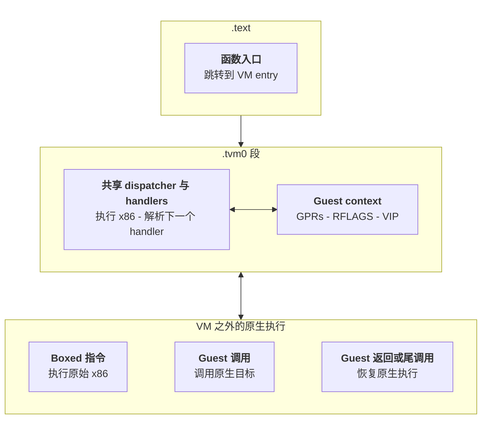

[中文](README.md)　 [English](README-EN.md)

# tvm-recover

[](https://doi.org/10.5281/zenodo.23474767)

关联 Zenodo 记录：[10.5281/zenodo.23474767](https://doi.org/10.5281/zenodo.23474767)。

>⚠️ **免责声明：** 本项目仅用于获得授权的安全研究、互操作性分析和教育，不包含或提供商业反作弊系统的绕过功能。使用者须确保拥有分析目标二进制文件的合法权利。

面向 Tencent VM 的虚拟化还原工具。从 `.tvm0` 段恢复虚拟化代码，提取每个 VM handler 对 guest 寄存器和内存做了什么，并能把还原出的函数写回二进制，作为只读可执行段，从而恢复PE便于读取。

```
.tvm0 段  ->  VM 语义  ->  guest 级 listing  ->  LLVM IR  ->  打过补丁的 PE
```

某个 VM root 的还原后 listing，guest 寄存器组在跨块绑定后的形式。


## 各组件恢复效果

下表按**成功生成机器码的函数数**计算恢复比例。生成的代码均通过了与项目解释器的结果对比。

| 组件 | 候选函数 | 已生成代码 | 恢复比例 |
| --- | ---: | ---: | ---: |
| `ACE-ADVT.sys` | 37 | 35 | **94.59%** |
| `ACE-ADVT-1.0.2604.17113.sys` | 37 | 34 | **91.89%** |
| `ACE-BASE.sys` | 274 | 254 | **92.70%** |
| `ACE-BOOT.sys` | 112 | 101 | **90.18%** |
| `ACE-CORE.sys` | 157 | 137 | **87.26%** |
| `ACE-CORE.sys2` | 102 | 85 | **83.33%** |
| `ACE-CORE.sys3` | 140 | 121 | **86.43%** |
| `ACE-GAME.sys` | 91 | 67 | **73.63%** |
| `ACE-SSC-DRV64.sys` | 192 | 162 | **84.38%** |


下表统计参考工具找到的跳转中恢复数量。衡量控制流覆盖程度，与上表的函数恢复比例分开统计。

| 组件 | 跳转恢复比例 |
| --- | ---: |
| `ACE-CORE.sys3` | **95.05%** |
| `ACE-CORE.sys` | **83.52%** |
| `ACE-CORE.sys2` | **92.24%** |
| `ACE-GAME.sys` | **94.37%** |
| `ACE-IDS64.dll` | **91.43%** |
| `ACE-CSI64.dll` | **95.86%** |
| `ACE-PBC-Game64.dll` | **99.79%** |
| `ACE-ATS64.dll` | **94.03%** |
| `ACE-BASE.sys` | **96.46%** |
| `SGuardAgent64.dll` | **100.00%** |
| `SGuard\x64\SGuard64.exe` | **95.47%** |
| `SGuard\x64\SGuardSvc64.exe` | **100.00%** |
| `SGuard\x64\SGuardUpdate64.exe` | **100.00%** |
| `SGuard\x64\ACE-Trace.dll` | **0.00%** |
| `ACE-Service64.exe` | **100.00%** |


## 构建

```bash
python -m venv .venv
source .venv/Scripts/activate      # Windows: .venv\Scripts\Activate.ps1
pip install -r requirements.txt
```

Python **3.13**、`capstone`。后端另需 `llvmlite==0.50.0`，Windows 上还需 MSVC `link.exe`/`cl.exe`。`z3-solver` 可选 —— 没有它时路径条件化仍在，只跳过有界 dispatch 证明。

## 配置

把 `.env.example` 复制为 `.env`，填上本机路径。`.env` 已 gitignore；每个配置项也都有命令行参数，文件只是提供默认值。

| 键 | 含义 |
| --- | --- |
| `TVM_MODULE` | 分析目标，供不带位置参数的 probe 使用 |
| `TVM_LISTINGS` | 后端读取的 listing 目录 |
| `TVM_OUT` | 所有输出的根目录（默认 `out/`） |
| `TVM_STEPS` | 每块步数上限，触顶即截断（默认 `900000`） |
| `TVM_BLOCKS` | 每 root 块预算（默认 `512`） |
| `TVM_PAYLOAD_OPT` | payload codegen 级别 `0`–`3` |
| `TVM_PAYLOAD_MEM` | `sealed` \| `absolute` guest 内存模式 |
| `TVM_MSVC_BIN` | 存放 `link.exe`/`cl.exe` 的目录，免去依赖 `PATH` |

优先级：命令行参数 → `.env` → 环境变量 → 内置默认值。

## 用法

引擎命令在 `engine/` 下执行；后端命令在仓库根目录执行。

### 找虚拟化代码

```bash
cd engine
python -m probe.scan_tvm0 /path/to/dir        # 哪些文件带 .tvm0，以及它的 root
python -m probe.trampoline_forms input.exe    # 入口跳板长什么样
python -m probe.mnemonic_census input.exe     # VM 里包含哪些 x86
```

### 还原

```bash
python -m core.devirt input.exe --out ../out/listings
```

每个函数产出一个 `0x<root>.txt` listing 和一个 `0x<root>.guest-state.json`。选项：

| 选项 | 默认 | 含义 |
| --- | --- | --- |
| `--out=DIR` | stdout | 写出 listing 与 guest state |
| `--root=0x…` | 全部发现的 | 只处理一个 VM 入口 |
| `--show[=N]` | 关 | 打印前 N 行 |
| `--steps=N` | `900000` | 每块步数上限，触顶即截断 |
| `--blocks=N` | `512` | 每 root 块预算 |
| `--caller-entry=0x… --call-site=0x…` | 关 | 对入口做 caller 特化 |

每个 listing 的头部会写明这次运行是否**被截断**；截断的 listing 是下界，不是完整函数。

### 理解单个函数

```bash
python -m probe.cfg_run         input.exe 0x14015fc2e    # 走一遍，打印 CFG
python -m probe.guest_effect    input.exe 0x14015fc2e    # handler 对 guest 寄存器的效果
python -m probe.ctx_map         input.exe 0x14015fc2e    # 哪个 context slot 存哪个 guest 寄存器

python -m probe.why_unresolved  input.exe 0x14015fc2e    # 某个 dispatch 为什么没解出
python -m probe.block_exits     input.exe 0x14015fc2e    # 某个块为什么没有后继
python -m probe.stop_debug      input.exe 0x14015fc2e    # 求值为什么停下
python -m probe.unresolved_detail input.exe 0x14015fc2e  # 逐块细节
```

追到具体某个值或某次写入：

```bash
python -m probe.trace_window    input.exe 0x14015fc2e 0x14015fc40 0x14015fc90
python -m probe.reg_history     input.exe 0x14015fc2e rax
python -m probe.who_wrote       input.exe 0x14015fc2e 0x18
python -m probe.flags_at        input.exe 0x14015fc2e 0x14015fc60
python -m probe.stack_at        input.exe 0x14015fc2e
```

### 写回二进制

```powershell
.\write-devirt.ps1 -Module 'C:\path\to\SGuardSvc64.exe'
```

依次跑 payload → 注入 → 加载 → 差分，遇到第一个失败就停下。选项：`-Listings`、`-Out`、`-Opt 0..3`、`-Mem sealed|absolute`、`-SkipDifferential`、`-Force`。

也可以逐个阶段单独跑：

```bash
cd llvm
python payload.py  --listings=../out/hard-cases-listings-final --out=../out/write-devirt --opt=0 --mem=sealed
python peinject.py --host=input.exe --payload=../out/write-devirt --out=../out/write-devirt/input.neko.exe
python miniload.py ../out/write-devirt/input.neko.exe
python diff_payload.py --payload=../out/write-devirt --patched=../out/write-devirt/input.neko.exe
```

真正有意义的是 `diff_payload.py`：它运行**打过补丁的镜像里的**代码，与解释器在同一 listing 上逐字节比对。`miniload.py` 只证明镜像能加载、入口能跑。

## VM 是怎么工作的

ACE 用一个跳板替换原生函数，跳入 VM dispatcher。dispatcher 执行的是原生 x86 handler，但被保护函数的体系结构状态存放在 VM context 中。



部分操作在 VM 之外执行。**Boxed 指令**在 VM 恢复它所需的寄存器后执行原始 x86 编码，再把效果写回 guest context。**Guest 调用**调用一个原生目标，返回时把返回值与 Windows x64 ABI 的 clobber 体现在 guest 状态里。Guest 返回与尾调用则完全离开 dispatcher。

context 包含全部十六个 guest 通用寄存器（含 guest `RSP`），以及打包的 guest 标志位。它的布局随保护版本变化，因此是通过观察 VM 的保存/恢复行为定位的，而不是假设固定地址 —— `probe.ctx_map` 报告在 store 处实测的映射，且每个输出的 listing 都会给 context 访问标注 slot 偏移。

条件控制流通过 dispatch 算术实现：handler 取出一个 guest 标志或谓词，用它选出下一个虚拟程序计数器，再算出下一个 handler 的地址。还原器符号化地求值这一过程，并在所选路径依赖未解析 guest 值时分裂求值状态。一个块的标识是 `(handler, vip)` 这一对，而不只是 handler。

整个还原建立在一条规则上：**按机器实际做了什么来识别值，而不是按分析给它的名字。** 跨块寄存器传播在 listing 中以注解形式携带，绝不作为证据 —— 把 listing 里每个寄存器版本号任意置换后，解析出的结构必须不变。

## 结构

```text
write-devirt.ps1   一条命令：payload -> 打过补丁的 PE -> 差分
.env.example       配置模板；复制为 .env
envfile.py         .env 解析；bootenv.py 供 llvm/ 加载，engine/envboot.py 供 probe 加载
engine/core/       PE 解析、表达式 arena、x86-64 lifting、机器模型、
                   guest context、CFG 恢复、guest IR、guest-state 程序
engine/probe/      28 个 probe —— 每个回答一个关于目标的问题
engine/tests/      30 个套件，全部基于合成 fixture 或 Python 独立算术对照
llvm/              listing 文法、IR -> LLVM IR、解释器、差分、
                   payload 构建、PE/PDB 编辑、注入、加载
llvm/runtime/      payload 调用的代码：密封内存、入口桩、__chkstk
out/               工具输出（已 gitignore）
```

## 范围

guest context 的布局是通过测量得出的，不是假设的：`probe.ctx_map` 报告在 store 处实测的 slot 与寄存器对应关系。一个块的标识是 `(handler, vip)` 这一对，而不只是 handler。
listing 是 VM 做过什么的记录，不是反编译结果。未解析的 dispatch 会被如实报告为未解析，而不是猜一个。截断的运行会在文件头标记。`--caller-entry` 产出的是以那个调用者为前提的结果，payload 拒绝把它提升为通用还原。

##  Thanks

基于 [capstone](https://www.capstone-engine.org/) 反汇编，基于 [llvmlite](https://llvmlite.readthedocs.io/) 做 LLVM 后端。
