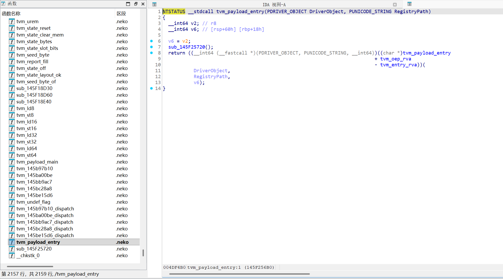
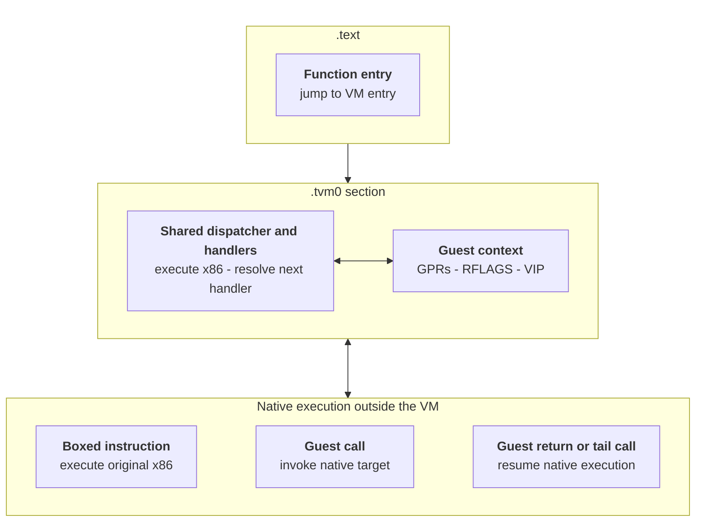

# tvm-recover

[](https://doi.org/10.5281/zenodo.23474767)

Related Zenodo record: [10.5281/zenodo.23474767](https://doi.org/10.5281/zenodo.23474767).

>⚠️ **Disclaimer:** This project is intended strictly for authorized security research, interoperability analysis, and education. It does not include or provide any bypass functionality for commercial anti-cheat systems. Users are solely responsible for ensuring they have the legal right to analyze the target binaries.

A devirtualizer for Tencent VM . Recovers the virtualized code in a `.tvm0`
section, lifts what each VM handler does to the guest's registers and memory, and can write the
recovered functions back into the binary as a normal read+execute section.

It is a tool: point it at a module, get structure and code back out.


```
.tvm0 section  ->  VM semantics  ->  guest-level listing  ->  LLVM IR  ->  patched PE
```

Devirtualized listing of a VM root, with the guest register file bound across blocks.



## Build

```bash
python -m venv .venv
source .venv/Scripts/activate      # Windows: .venv\Scripts\Activate.ps1
pip install -r requirements.txt
```

Python **3.13**, `capstone`. For the backend: `llvmlite==0.50.0` and, on Windows, MSVC
`link.exe`/`cl.exe`. `z3-solver` is optional — without it path conditioning stays and only the
bounded dispatch proof is skipped.

## Configuration

Copy `.env.example` to `.env` and fill in the paths for this machine. `.env` is git-ignored, and
every setting also has a command-line flag, so the file only supplies defaults.

| key | meaning |
| --- | --- |
| `TVM_MODULE` | the module to analyse, for probes run without a positional argument |
| `TVM_LISTINGS` | listing corpus the backend reads |
| `TVM_OUT` | root for all output (default `out/`) |
| `TVM_STEPS` | steps per block before a block is truncated (default `900000`) |
| `TVM_BLOCKS` | block budget per root (default `512`) |
| `TVM_PAYLOAD_OPT` | payload codegen level `0`–`3` |
| `TVM_PAYLOAD_MEM` | `sealed` \| `absolute` guest-memory mode |
| `TVM_MSVC_BIN` | directory holding `link.exe`/`cl.exe`, instead of relying on `PATH` |

Precedence: command-line flag → `.env` → environment → built-in default.

## Usage

Engine commands run from `engine/`; backend commands from the repository root.

### Find the virtualized code

```bash
cd engine
python -m probe.scan_tvm0 /path/to/dir        # which files carry a .tvm0, and its roots
python -m probe.trampoline_forms input.exe    # what the entry trampolines look like
python -m probe.mnemonic_census input.exe     # what x86 the VM contains
```

### Devirtualize

```bash
python -m core.devirt input.exe --out ../out/listings
```

One `0x<root>.txt` listing and one `0x<root>.guest-state.json` per function. Options:

| flag | default | meaning |
| --- | --- | --- |
| `--out=DIR` | stdout | write listings + guest state |
| `--root=0x…` | all discovered | restrict to one VM entry |
| `--show[=N]` | off | print the first N lines |
| `--steps=N` | `900000` | steps per block before truncation |
| `--blocks=N` | `512` | block budget per root |
| `--caller-entry=0x… --call-site=0x…` | off | caller-specialize the entry |

The header of each listing says whether the run was **truncated**; a truncated listing is a lower
bound, not the function.

### Understand one function

```bash
python -m probe.cfg_run         input.exe 0x14015fc2e    # walk it, print the CFG
python -m probe.guest_effect    input.exe 0x14015fc2e    # what handlers do to guest registers
python -m probe.ctx_map         input.exe 0x14015fc2e    # which context slot holds which register

python -m probe.why_unresolved  input.exe 0x14015fc2e    # why a dispatch did not resolve
python -m probe.block_exits     input.exe 0x14015fc2e    # why a block has no successor
python -m probe.stop_debug      input.exe 0x14015fc2e    # why evaluation stopped
python -m probe.unresolved_detail input.exe 0x14015fc2e  # per-block detail
```

Drill into a specific value or store:

```bash
python -m probe.trace_window    input.exe 0x14015fc2e 0x14015fc40 0x14015fc90
python -m probe.reg_history     input.exe 0x14015fc2e rax
python -m probe.who_wrote       input.exe 0x14015fc2e 0x18
python -m probe.flags_at        input.exe 0x14015fc2e 0x14015fc60
python -m probe.stack_at        input.exe 0x14015fc2e
```

### Write it back into the binary

```powershell
.\write-devirt.ps1 -Module 'C:\path\to\SGuardSvc64.exe'
```

Runs payload → inject → load → differential and stops at the first stage that fails. Options:
`-Listings`, `-Out`, `-Opt 0..3`, `-Mem sealed|absolute`, `-SkipDifferential`, `-Force`.

The stages individually:

```bash
cd llvm
python payload.py  --listings=../out/hard-cases-listings-final --out=../out/write-devirt --opt=0 --mem=sealed
python peinject.py --host=input.exe --payload=../out/write-devirt --out=../out/write-devirt/input.neko.exe
python miniload.py ../out/write-devirt/input.neko.exe
python diff_payload.py --payload=../out/write-devirt --patched=../out/write-devirt/input.neko.exe
```

`diff_payload.py` is the check that matters: it runs the code **inside the patched image** and
compares it byte for byte against the interpreter over the same listing. `miniload.py` only proves
the image loads and its entry runs.

## How the VM works

ACE replaces a native function with a trampoline into a VM dispatcher. The dispatcher executes
native x86 handlers, but the protected function's architectural state lives in the VM context.



Some operations execute outside the VM. A **boxed instruction** runs its original x86 encoding after
the VM restores the registers it needs, then returns its effects to the guest context. A **guest
call** invokes a native target and resumes with the return value and Windows x64 ABI clobbers
represented in guest state. Guest returns and tail calls leave the dispatcher entirely.

The context holds all sixteen guest general-purpose registers, including the guest `RSP`, plus
packed guest flags. Its layout varies by protector build, so it is located by observing the VM's
save/restore behaviour rather than assumed — `probe.ctx_map` reports the mapping measured at the
stores, and every emitted listing brackets a context access with its slot offset.

Conditional control flow is dispatch arithmetic: a handler extracts a guest flag or predicate, uses
it to pick the next virtual program counter, and computes the next handler's address. The
devirtualizer evaluates that symbolically and forks when the choice depends on an unresolved guest
value. A block's identity is the pair `(handler, vip)`, not the handler alone.

The recovery rests on one rule: **identify a value by what the machine did, not by the name an
analysis gave it.** Register propagation across blocks is carried in the listing as an annotation,
never as evidence — permuting every register version number in a listing must not change the parsed
structure.

## Layout

```text
write-devirt.ps1   one command: payload -> patched PE -> differential
.env.example       configuration template; copy to .env
envfile.py         .env parser; bootenv.py loads it for llvm/, engine/envboot.py for probes
engine/core/       PE parsing, expression arena, x86-64 lifting, machine model,
                   guest context, CFG recovery, guest IR, guest-state programs
engine/probe/      28 probes - each answers one question about the target
engine/tests/      30 suites, all on synthetic fixtures or independent Python arithmetic
llvm/              listing grammar, IR -> LLVM IR, interpreter, differential,
                   payload builder, PE/PDB editor, injector, loader
llvm/runtime/      the code the payload calls: sealed memory, entry stub, __chkstk
out/               tool output (git-ignored)
```

## Scope

The guest context layout is derived by measurement, not assumed: `probe.ctx_map` reports which
context slot holds which guest register, measured at the stores. A block's identity is the pair
`(handler, vip)`, not the handler alone.

What the output does not claim: a listing is a record of what the VM did, not a decompilation.
An unresolved dispatch is reported as unresolved rather than guessed. A truncated run is marked in
the file header. `--caller-entry` produces a result conditional on that caller, and the payload
refuses to promote it to a general recovery.

## Credits

Built on [capstone](https://www.capstone-engine.org/) for disassembly and
[llvmlite](https://llvmlite.readthedocs.io/) for the LLVM backend.
